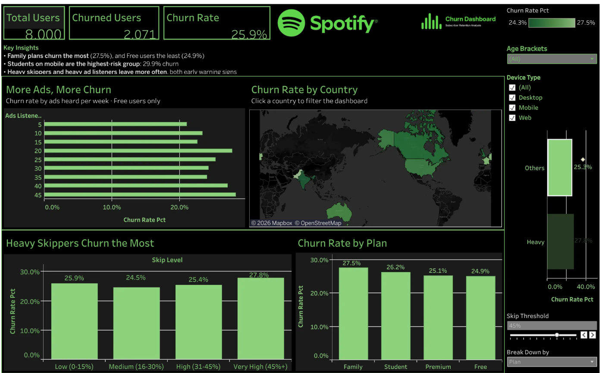

# Spotify Subscriber Churn Dashboard

**An interactive Tableau dashboard that explores which Spotify users cancel, and what they have in common.**

🔗 **[View the live dashboard on Tableau Public](ADD-YOUR-TABLEAU-PUBLIC-LINK-HERE)**



---

## The Business Question

About 1 in 4 users in this dataset cancelled their subscription. Keeping an existing subscriber is usually cheaper than winning a new one, so this project asks:

> **Which users are most likely to churn, and where should a retention team focus first?**

## Dataset

| | |
|---|---|
| **Source** | Spotify churn dataset ([Kaggle — add link](ADD-DATASET-LINK-HERE)) |
| **Size** | 8,000 users, 12 columns |
| **Key fields** | plan type, device, country, age, gender, listening time, songs per day, skip rate, ads per week, offline listening, churned (1/0) |

## Headline Numbers

| Total Users | Churned Users | Churn Rate |
|---:|---:|---:|
| 8,000 | 2,071 | **25.9%** |

## Key Insights

**1. Family plans have the highest churn, and Free has the lowest.**
Family plan users churn at **27.5%**, compared with **24.9%** for Free users. You might expect paying customers to be more loyal, but here they are not. A Family plan depends on several people agreeing to keep it, so it has more ways to fall apart.

**2. Students on mobile are the highest-risk group.**
Student users on Mobile churn at **29.9%** (625 users), the highest of any plan and device combination. Free users on Web churn the least, at **22.3%**.

**3. Heavy skippers are more likely to leave.**
Users who skip at least 45% of their songs churn at **27.8%**, compared with **25.3%** for everyone else. Frequent skipping can be an early sign that the recommendations aren't working for that user.

**4. For Free users, more ads means more churn.**
Only Free users hear ads. Among them, churn rises steadily with ad load:

| Ads per week | Churn rate |
|---|---:|
| 1–15 | 22.7% |
| 16–30 | 24.5% |
| 31–49 | 26.4% |

**5. Churn is fairly even across countries.**
Pakistan (27.5%), Germany (27.3%) and France (27.2%) are highest, and India (24.3%) is lowest. The spread is only about 3 percentage points. That suggests the cause is product experience rather than any single market.

## Recommendations

These are hypotheses to test, not proven causes:

1. **Family plans:** run retention outreach before renewal, for example reminders that highlight shared playlists and household value.
2. **Students on mobile:** review the mobile experience for student accounts, since this is the riskiest segment.
3. **Heavy skippers:** use a high skip rate as an early warning, and trigger better recommendations or a "re-tune your mix" prompt.
4. **Free-tier ads:** A/B test a lower ad cap of around 15 per week, and measure whether churn and upgrades improve.

## Dashboard Features

- **KPI tiles** showing total users, churned users and churn rate.
- **Clickable world map:** click a country to filter every chart on the dashboard.
- **"Break Down By" parameter:** switch one chart between Plan, Device, Gender and Age Bracket.
- **Skip Threshold parameter:** a slider (10%–60%) that redefines a "heavy skipper" and updates the comparison live.
- **Filters** for age bracket and device type.

## How It Was Built

**Tool:** Tableau Desktop, published to Tableau Public.

**Calculated fields:**

| Field | Formula / logic | Purpose |
|---|---|---|
| Total Users | `COUNT([user_id])` | KPI |
| Churn Rate Pct | `AVG([is_churned])` | Churn rate. Because churned = 1 and stayed = 0, the average is the churn rate. |
| Age Brackets | `IF [age] < 25 THEN "15-24" ELSEIF …` | Groups ages for comparison |
| Skip Level | Groups `skip_rate` into Low / Medium / High / Very High | Skip behavior groups |
| Chosen Dimension | `CASE [Break Down by] WHEN "Plan" THEN [subscription_type] …` | Drives the Break Down By parameter |
| Skip Group | `IF [skip_rate] >= [Skip Threshold] THEN "Heavy Skippers" ELSE "Everyone Else" END` | Drives the Skip Threshold slider |

**Other techniques:** a filter action from the map, a bins field for ads per week, and two parameters.

## Limitations

- **The differences are small.** Every group falls between roughly 22% and 30% churn. With 8,000 users, none of the gaps passed a chi-square test at the 5% level, so these insights are directional and need more data to confirm.
- **Some features overlap.** Only Free users hear ads, and no Free users have offline listening. So "ads" and "offline listening" can't be separated from "being on the Free plan."
- **The data may be simulated.** Users are spread almost perfectly evenly across countries and plans, which is typical of practice datasets. Real Spotify data would likely show stronger patterns.

## What I'd Do Next

- Add time data, such as signup and cancel dates, to see *when* users churn.
- Build a simple churn prediction model (logistic regression) to score each user's risk.
- Compare revenue lost per segment, not just the churn count.

## Repository Contents

```
├── README.md
├── Spotify_Subscriptions_Dashboard.twbx   # Tableau packaged workbook
├── data/
│   └── spotify_churn_dataset.csv
└── images/
    └── dashboard.png                      # screenshot used above
```

## Author

**Darell Garay**: [LinkedIn](ADD-LINK) · [Tableau Public](ADD-LINK)
